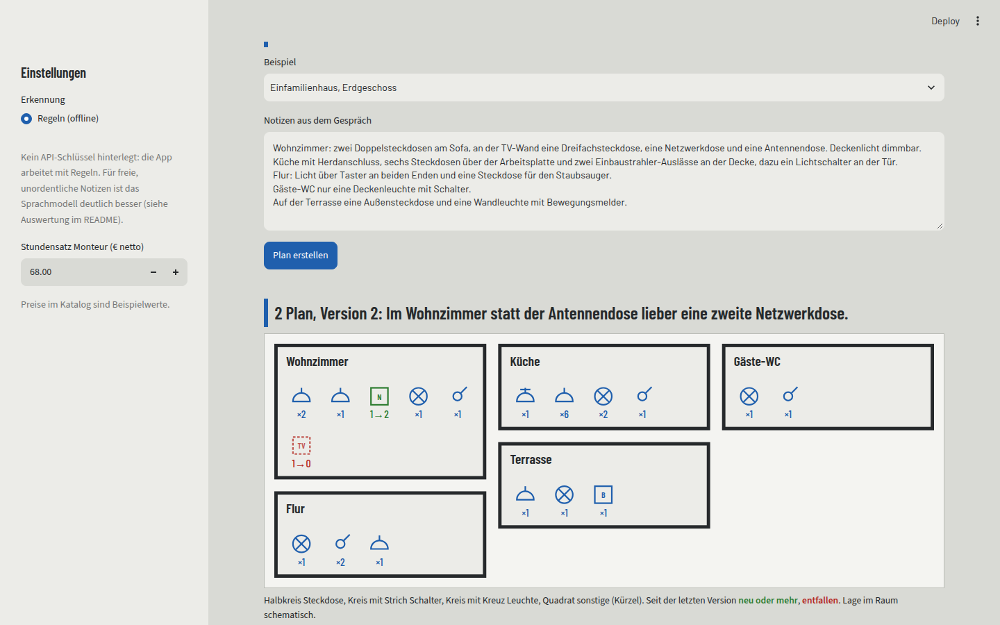

# Wunschplan

**KI-Projekt 2026** | [Portfolio](https://sayamrina.github.io/)

Im Kundengespräch notiert die Elektrofachkraft, was der Kunde in welchem Raum haben möchte: „links und rechts vom Bett je eine Doppelsteckdose, Licht an der Tür und am Bett schaltbar“. Wunschplan macht daraus in einem Schritt **Positionen**, einen **schematischen Installationsplan** und ein **Angebot**. Ruft der Kunde später an und möchte etwas ändern („statt der Antennendose lieber eine zweite Netzwerkdose“), wird der Wunsch als neue Version eingetragen; Plan und Angebot zeigen, was sich geändert hat und was es kostet.

*English: turns an electrician's notes from a customer meeting into line items, a schematic installation plan and a quote, and applies later change requests as new versions with a visible diff. The interface is in German.*



## Ablauf

1. **Kundenwünsche erkennen.** Ein Sprachmodell (gpt-4o-mini) liest die Notizen und gibt strukturierte Positionen zurück. Es darf nur Räume und Komponenten aus dem Katalog wählen: das Pydantic-Schema wird als Structured Output erzwungen, freie Bezeichnungen sind nicht möglich. Unklares (fehlender Raum, fehlende Anzahl) landet als Frage in „Offene Fragen“, statt geraten zu werden. Ohne API-Schlüssel arbeitet die App mit Regeln (Offline-Modus).
2. **Prüfen und korrigieren.** Die Fachkraft sieht alle Positionen in einer Tabelle und kann sie direkt ändern. Der Plan gehört ihr, nicht dem Modell.
3. **Plausibilität im Code.** Regeln wie „Rauchwarnmelder in Schlafräumen, Kinderzimmern und Fluren“, „Wechselschaltung braucht zwei Schalter“, „Herdanschluss auf eigenem Stromkreis“ oder „Steckdose im Bad: Schutzbereiche nach DIN VDE 0100-701“ prüft der Code, nicht das Modell. Es sind Hinweise, keine Normprüfung.
4. **Angebot.** Material und Montage (Minuten × Stundensatz) je Komponente, Netto, MwSt. und Brutto werden im Code gerechnet; das Modell nennt keine Preise. Export als CSV.
5. **Änderungswünsche als Versionen.** Jede Änderung ergibt eine neue Version mit Unterschied (vorher, nachher), Mehr- oder Minderkosten und Markierung im Plan. Die letzte Version lässt sich verwerfen.

## Auswertung

[`evaluieren.py`](evaluieren.py) vergleicht die erkannten Positionen mit von Hand annotierten Fällen in [`data/eval`](data/eval). Eine Position zählt nur, wenn Raum, Komponente **und** Anzahl stimmen.

| Datensatz | Fälle | Regeln (offline) |
|---|---|---|
| Extraktion, dev (beim Schreiben der Regeln benutzt) | 6 | F1 1,00, 6/6 exakt |
| Extraktion, holdout (vor den Regeln geschrieben) | 12 | F1 1,00, 12/12 exakt |
| Extraktion, stress (Kürzel, Tippfehler, indirekte Wünsche; nicht zum Abstimmen benutzt) | 8 | **F1 0,50, 1/8 exakt** |
| Änderungen, dev | 5 | 5/5 exakt |
| Änderungen, holdout | 6 | 6/6 exakt |

Was die Zahlen bedeuten: Holdout-Fälle und Regeln stammen von derselben Person und sind im selben ordentlichen Stil formuliert, deshalb sagen die 100 % wenig über echte Notizen. Der Stress-Datensatz zeigt die Grenze der Regeln: „SZ: 2x Doppel-SD“, „Kinderzimer“ (Tippfehler), „das gleiche wie im Schlafzimmer“ oder „Sat, LAN und 3er Steckdose“ erkennen sie nicht. Genau dafür ist das Sprachmodell da. Die Auswertung des Modells läuft mit eigenem Schlüssel:

```bash
export OPENAI_API_KEY=...
python evaluieren.py --modus llm --fehler
```

Die Ergebnisse des Modells sind hier noch nicht eingetragen.

## Grenzen

- Der Plan ist schematisch: ein Kasten je Raum, keine Maße und keine Lage an der Wand. Der echte Grundriss entsteht in der Planungssoftware.
- Katalog und Preise sind Beispielwerte.
- Die Prüfregeln sind eine kleine Auswahl und ersetzen weder DIN 18015 noch die Fachkraft.
- Die Datensätze sind klein (37 Fälle) und selbst geschrieben, nicht aus echten Kundengesprächen.

## Lokal starten

```bash
python -m venv .venv && . .venv/bin/activate
pip install -r requirements.txt
export OPENAI_API_KEY=...   # optional, sonst Offline-Modus mit Regeln
streamlit run streamlit_app.py
```

Tests und Linting:

```bash
pip install pytest ruff
ruff check . && pytest
```

Die 15 Tests prüfen Erkennung und Änderungen gegen dev und holdout, das Angebot (Material, Montage, MwSt.), die Prüfregeln, den Plan mit Markierungen und die App als Ganzes (Streamlit AppTest: Plan erstellen, Änderung eintragen, Version verwerfen).

## Aufbau

| Datei | Aufgabe |
|---|---|
| [`wp/katalog.py`](wp/katalog.py) | Komponenten, Räume, Beispielpreise |
| [`wp/schema.py`](wp/schema.py) | Datenmodell (Pydantic), auch Schema für das Sprachmodell |
| [`wp/llm.py`](wp/llm.py) | Erkennung und Änderungen mit Structured Output |
| [`wp/regeln.py`](wp/regeln.py), [`wp/aenderung.py`](wp/aenderung.py) | Offline-Modus mit Regeln, Unterschied zwischen Versionen |
| [`wp/pruefung.py`](wp/pruefung.py), [`wp/angebot.py`](wp/angebot.py) | Plausibilität und Angebot im Code |
| [`wp/grundriss.py`](wp/grundriss.py) | Plan als SVG, Symbole angelehnt an EN 60617 |

This app was built by Amrina, with AI as a supporting tool for coding.
